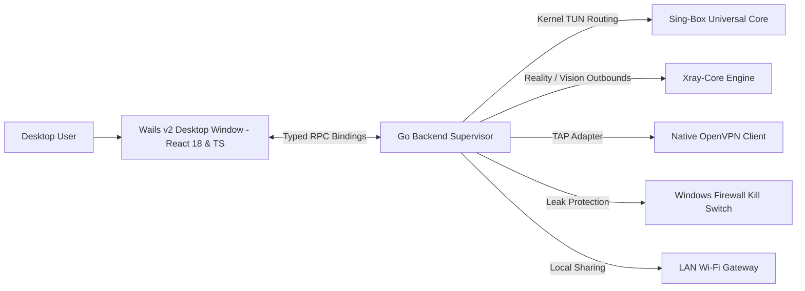

<div align="center">

# ⚡ NexVPN Pro Client ⚡
### Next-Generation Multi-Protocol Anti-Censorship Desktop Client for Windows

[](https://github.com/Rpg-420/NexVPN)
[](LICENSE)
[](https://github.com/Rpg-420/NexVPN)
[](https://go.dev)
[](https://reactjs.org)
[](https://t.me/nexvpnpro)

[English](README.md) • [فارسی](README_FA.md) • [User Guide](docs/USER_GUIDE.md) • [Developer Guide](docs/DEVELOPER_GUIDE.md)

</div>

---

## 🌟 Introduction

**NexVPN Pro** is a high-performance, open-source multi-protocol VPN and anti-censorship desktop client tailored for Windows. By uniting three industry-standard core daemons — **Sing-Box**, **Xray-Core**, and **Native OpenVPN** — with **Wintun kernel-level virtual network adapter routing**, NexVPN delivers blazing-fast speeds, rock-solid stability, and deep packet inspection (DPI) evasion under harsh network conditions.

---

## ✨ Key Features

| Feature | Description |
| :--- | :--- |
| 🚀 **Universal Protocols** | Full native support for `VLESS Reality`, `VLESS Vision`, `VMess`, `Trojan`, `Shadowsocks`, `Hysteria 2`, `TUIC`, `WireGuard`, `WARP`, and `OpenVPN`. |
| 🛡️ **Dual-Routing Engine** | Transparently merges **Wintun Kernel TUN** adapter with system WinINet proxy for guaranteed 100% application traffic coverage. |
| 🔬 **DPI Evasion & Fragment Studio** | Splits TLS `ClientHello` handshakes into micro-packets with custom jitter to defeat SNI filtering and deep inspection firewalls. |
| 🎮 **Ultra-Low Latency Gaming Mode** | Tailored MTU (1400), MSS clamping (1360), UDP priority routing, and anti-sanction gaming DNS (**Electro**, **Shecan**, **Begzar**, **Cloudflare Zero Trust**). |
| 🔗 **Proxy Chaining & Multi-Hop** | Route traffic sequentially through up to 4 relay nodes for ultimate privacy, bypass, and ISP unthrottling. |
| ⚡ **1-Click Free Cloudflare WARP** | Instant WARP registration, WireGuard key generation, and Double WARP (WARP-on-WARP) chaining. |
| 📡 **Wi-Fi LAN Proxy Sharing** | Turn your PC into a gateway proxy to unblock smartphones, PlayStation, Xbox, and Smart TVs on your local network. |
| 📱 **Mobile Remote Control Hub** | Scan a local QR code with your smartphone to control and monitor NexVPN directly from your mobile browser. |
| 🩺 **Smart Network Doctor** | 1-click diagnostic & recovery tool to flush DNS, reset Winsock, and repair residual proxy states. |
| 📊 **Real-Time Telemetry & Quota** | Live upload/download gauges, zero-lag dynamic traffic graph, and monthly data limit tracking. |
| 🌐 **Modern Bilingual UI** | Sleek Cyberpunk/Dark UI with seamless Persian (RTL with Vazirmatn font) and English (LTR) language support. |

---

## 🏗️ Architecture Overview



---

## 🚀 Quick Start & Installation

### Option 1: Download Pre-built Release
1. Download the latest `NexVPN-v1.1.0-Setup.exe` or portable `NexVPN.exe` from the [Releases](https://github.com/Rpg-420/NexVPN/releases) page.
2. Run `NexVPN.exe` (Administrator privileges required for TUN adapter setup).
3. Import your V2Ray config link / subscription, or click **1-Click Register WARP**.
4. Click **Connect** and enjoy uncensored internet!

### Option 2: Build from Source

#### Prerequisites
* [Go 1.22+](https://go.dev/dl/)
* [Node.js 18+](https://nodejs.org/) & `npm`
* [Wails CLI v2](https://wails.io/): `go install github.com/wailsapp/wails/v2/cmd/wails@latest`
* [go-winres](https://github.com/tc-hib/go-winres): `go install github.com/tc-hib/go-winres@latest`

#### Compilation
```powershell
# Clone the repository
git clone https://github.com/Rpg-420/NexVPN.git
cd NexVPN

# Install frontend dependencies
cd frontend
npm install
cd ..

# Build production executable
powershell -ExecutionPolicy Bypass -File .\build.ps1
```
The compiled self-contained binary will be ready at `build\bin\NexVPN.exe`.

---

## ⌨️ Desktop Global Shortcuts

| Shortcut | Action |
| :--- | :--- |
| `Ctrl + Shift + C` | Toggle VPN Connect / Disconnect |
| `Ctrl + Shift + S` | Run Real-Time Speed Benchmark |
| `Ctrl + Shift + R` | Open ISP Status Radar |
| `Ctrl + Shift + L` | Toggle Wi-Fi LAN Proxy Sharing |
| `Ctrl + Shift + E` | Trigger Emergency Network Repair |
| `Ctrl + Shift + Q` | Open Data Quota Manager |

---

## 🤝 Community & Support

* 📢 **Telegram Channel**: [@nexvpnpro](https://t.me/nexvpnpro)
* 💬 **Support & Feedback**: [@nexvpnpro](https://t.me/nexvpnpro)
* 🐛 **Issue Tracker**: [GitHub Issues](https://github.com/Rpg-420/NexVPN/issues)

---

## 📄 License
Released under the [MIT License](LICENSE). Built for privacy and internet freedom worldwide.
