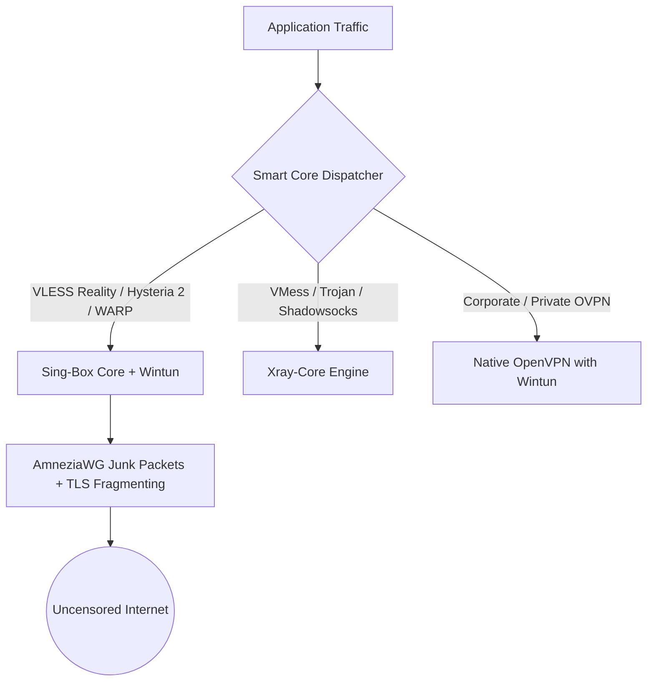

<div align="center">

# ⚡ NexVPN Pro Client ⚡
### Next-Generation Multi-Protocol Anti-Censorship Desktop Client for Windows

[](https://github.com/Rpg-420/NexVPN/releases)
[](https://github.com/Rpg-420/NexVPN/actions)
[](https://github.com/Rpg-420/NexVPN)
[](https://github.com/Rpg-420/NexVPN)
[](LICENSE)
[](https://t.me/nexvpnpro)

[English](README.md) • [فارسی](README_FA.md) • [Documentation](docs/USER_GUIDE.md)

</div>

---

## 📑 Table of Contents

- [🌟 Introduction](#-introduction)
- [✨ Key Features](#-key-features)
- [💻 System Requirements](#-system-requirements)
- [🚀 Installation & Setup](#-installation--setup)
- [📖 User Guide & Key Workflows](#-user-guide--key-workflows)
- [🏗️ System Architecture & Project Structure](#️-system-architecture--project-structure)
- [🛡️ Anti-Censorship & Protocols](#️-anti-censorship--protocols)
- [🔒 Security & Privacy Shield](#-security--privacy-shield)
- [⌨️ Global Keybindings](#️-global-keybindings)
- [🤝 Contributing](#-contributing)
- [📜 License & Copyright](#-license--copyright)
- [💬 Support & Community](#-support--community)
- [💖 Acknowledgments](#-acknowledgments)

---

## 🌟 Introduction

**NexVPN Pro** is a modern, open-source multi-protocol VPN and anti-censorship desktop client tailored for Windows. By uniting three industry-standard core engines — **Sing-Box**, **Xray-Core**, and **Native OpenVPN** — with **Wintun kernel-level virtual network adapter routing**, NexVPN delivers ultra-low latency, rock-solid stability, and deep packet inspection (DPI) evasion under harsh and firewalled network conditions.

---

## ✨ Key Features

| Feature | Description |
| :--- | :--- |
| 🚀 **Universal Protocols** | Native support for `VLESS Reality`, `VLESS Vision`, `VMess`, `Trojan`, `Shadowsocks`, `Hysteria 2`, `TUIC`, `WireGuard`, `Cloudflare WARP`, `AmneziaWG`, and `OpenVPN`. |
| 🛡️ **Dual-Routing Wintun Engine** | Transparently merges **Wintun Kernel Layer-3 TUN** adapter with system WinINet proxy for guaranteed 100% application traffic coverage. |
| ⚡ **AmneziaWG Anti-DPI Obfuscation** | Fully configurable junk packet count (`Jc`), payload sizing (`Jmin`/`Jmax`), and randomized handshake magic headers (`H1`-`H4`) to bypass DPI blocks on any IP range. |
| 🔭 **Discovery Hub & Config Scanner** | Automatically aggregates, health-tests, and live-filters hundreds of verified free nodes, MTProto proxies, and Cloudflare Anycast endpoints. |
| 🔬 **TLS Fragment Studio** | Splits TLS `ClientHello` handshakes into micro-packets with custom jitter to defeat SNI filtering and middlebox censorship. |
| 🎯 **Clean Anycast IP Scanner** | Multithreaded Anycast scanner that benchmarks zero-loss Cloudflare endpoints and auto-generates optimized WARP / AmneziaWG configs. |
| 🎮 **Gaming Mode & Anti-Sanction** | Tailored MTU (1400), MSS clamping (1360), UDP priority routing, and anti-sanction gaming DNS (**Electro**, **Shecan**, **Begzar**, **Cloudflare Zero Trust**). |
| 🔗 **Proxy Chaining & Multi-Hop** | Route traffic sequentially through up to 4 relay nodes for ultimate privacy, bypass, and ISP unthrottling. |
| 📡 **Wi-Fi LAN Gateway Sharing** | Turn your PC into an encrypted gateway to unblock smartphones, PlayStation, Xbox, and Smart TVs on your local network. |
| 📱 **Mobile Remote Control Hub** | Scan a local QR code with your smartphone to control, switch nodes, and monitor NexVPN directly from your mobile browser. |
| 🩺 **Smart Network Doctor** | 1-click diagnostic & recovery tool to flush DNS, reset Winsock, kill residual proxies, and repair system network state. |
| 📊 **Real-Time Telemetry & Quota** | Live upload/download gauges, zero-lag dynamic traffic graph, monthly data quota limiter, and persistent session history. |
| 🌐 **Modern Bilingual UI** | Sleek Cyberpunk/Dark UI with seamless Persian (RTL with Vazirmatn font) and English (LTR) language support. |

---

## 💻 System Requirements

- **Operating System:** Windows 10 (64-bit) / Windows 11 (64-bit)
- **Architecture:** x86_64 (amd64)
- **Privileges:** Administrator privileges required for Wintun virtual network adapter installation and system routing.
- **Memory & Storage:** 250 MB RAM, 100 MB free disk space.

---

## 🚀 Installation & Setup

### Option 1: Portable Release (Recommended)

1. Download the latest `NexVPN-v1.3.3-Portable-x64.zip` from [GitHub Releases](https://github.com/Rpg-420/NexVPN/releases).
2. Extract the archive to your preferred folder (e.g. `C:\NexVPN`).
3. Run `NexVPN.exe` as Administrator.
4. Choose or import a profile and click **Connect**.

### Option 2: Build from Source

#### Prerequisites
* [Go 1.22+](https://go.dev/dl/)
* [Node.js 18+](https://nodejs.org/) & `npm`
* [Wails CLI v2](https://wails.io/): `go install github.com/wailsapp/wails/v2/cmd/wails@latest`
* [PowerShell 7+](https://github.com/PowerShell/PowerShell)

#### Compilation Steps
```powershell
# Clone the repository
git clone https://github.com/Rpg-420/NexVPN.git
cd NexVPN

# Install frontend dependencies
cd frontend
npm install
cd ..

# Build release package with automated tests & binary bundling
powershell -ExecutionPolicy Bypass -File .\package.ps1
```
The compiled self-contained bundle will be located at:
`dist\NexVPN-v1.3.3-Windows-x64\NexVPN.exe`

---

## 📖 User Guide & Key Workflows

### 1. Connecting to V2Ray / Xray Nodes
- Click **Import** or paste your `vless://`, `vmess://`, `trojan://`, `ss://`, or `hy2://` link into the dashboard.
- Select your node from the dropdown or click **Ping All** (`⚡`) to find the lowest-latency server.
- Click the central **Connect Orb** button.

### 2. 1-Click Cloudflare WARP & AmneziaWG
- Navigate to the **WireGuard & WARP** page.
- Click **1-Click Generate WARP** or use the **Clean IP Scanner** to discover low-latency Anycast endpoints.
- AmneziaWG anti-censorship junk headers are automatically embedded to guarantee connectivity across all ISPs.

### 3. OpenVPN with Auto-Timeout & Wintun Acceleration
- Import your `.ovpn` configuration file and enter your username/password if required.
- The Engine automatically configures MTU clamping (1360) and 512-packet anti-jitter replay protection for seamless streaming.
- If credentials or ports are incorrect, smart diagnostic popups alert you immediately.

### 4. Discovery Hub
- Open **Discovery Hub** to fetch hundreds of public verified configs, Telegram MTProto proxies, and Cloudflare clean targets.
- Filter by protocol (`VLESS`, `VMESS`, `TROJAN`, `SHADOWSOCKS`, `HYSTERIA2`), run batch latency tests, and import working servers with 1 click.

### 5. Wi-Fi LAN Sharing
- Click **LAN Share** in the top action bar or press `Ctrl + Shift + L`.
- Enable the gateway and set your Smart TV, Console, or Mobile Wi-Fi proxy to the displayed local IP and port `10809`.

---

## 🏗️ System Architecture & Project Structure

```
NexVPN/
├── app.go                       # Wails Go application entrypoint & frontend IPC bindings
├── app_discovery.go             # Discovery Hub IPC handlers
├── app_extra.go                 # Advanced network tools & batch IP testing IPC
├── main.go                      # Core bootstrap, single-instance mutex, and system tray
├── version.go                   # Central version definition
├── internal/
│   ├── config/                  # Store, encrypted persistent JSON, and session history
│   ├── core/                    # Engine supervisor, dispatcher, health monitor, failover
│   ├── discovery/               # Public free configs aggregator, Telegram proxies, ISP ratings
│   ├── parser/                  # URI decoders, sing-box/xray builders, AmneziaWG parser, scanner
│   ├── protocols/               # Adapter abstractions for sing-box, xray, and openvpn
│   ├── sysproc/                 # Process isolation, Windows job objects, and hidden windows
│   ├── sysproxy/                # WinINet proxy modifier and PAC server
│   └── tray/                    # Windows system notification area tray icon and menu
├── frontend/
│   ├── src/
│   │   ├── pages/               # Dashboard, V2RayPage, WarpWireGuardPage, OpenVPNPage, DiscoveryHub, Settings, Logs
│   │   ├── components/          # Modals: Doctor, SpeedTest, LANShare, RemoteHub, CleanIPScanner
│   │   ├── lib/                 # Wails API bridges, i18n localization (FA/EN), offline QR generator
│   │   └── types/               # Shared TypeScript schemas and RPC definitions
│   └── vite.config.ts           # Vite bundle configuration
└── bin/                         # Core engines: sing-box.exe, xray.exe, openvpn.exe, wintun.dll
```

---

## 🛡️ Anti-Censorship & Protocols



- **AmneziaWG Protocol Obfuscation:** Custom `Jc`, `Jmin`, `Jmax`, `S1`, `S2`, and `H1`-`H4` packet fields scramble handshake signatures, defeating deep packet inspection firewalls.
- **TLS ClientHello Fragmentation:** Slices the initial TLS handshake into tiny TCP segments (1-3 bytes with microsecond intervals) to prevent middlebox SNI blocking.
- **Adaptive Dual Routing:** High-speed Wintun TUN adapter routes system-wide UDP/TCP traffic while local HTTP/SOCKS5 proxy handles browser traffic.

---

## 🔒 Security & Privacy Shield

- **Firewall Kill Switch:** Restricts all outbound networking strictly to the active VPN tunnel to eliminate IP leaks during sudden disconnections.
- **Zero DNS Leaks:** DNS queries are resolved remotely through the encrypted tunnel via DoH (`1.1.1.1` / `8.8.8.8`) with dedicated domestic bypass for local domains.
- **Privacy Shield:** Sensitive authentication tokens, passwords, and server UUIDs are dynamically redacted from runtime logs.

---

## ⌨️ Global Keybindings

| Shortcut | Action |
| :--- | :--- |
| `Ctrl + Shift + C` | Toggle VPN Connect / Disconnect |
| `Ctrl + Shift + S` | Run Real-Time Speed Benchmark |
| `Ctrl + Shift + R` | Open ISP Status Radar |
| `Ctrl + Shift + L` | Toggle Wi-Fi LAN Proxy Sharing |
| `Ctrl + Shift + E` | Trigger Emergency Network Repair |
| `Ctrl + Shift + D` | Open DNS Leak Test |
| `Ctrl + Shift + F` | Launch DPI Evasion & Fragment Studio |
| `Ctrl + Shift + Q` | Open Monthly Quota Manager |

---

## 🤝 Contributing

Contributions, bug reports, and feature proposals are warmly welcomed!

1. Fork the repository on GitHub.
2. Create your feature branch (`git checkout -b feature/AmazingFeature`).
3. Commit your changes (`git commit -m 'feat: Add AmazingFeature'`).
4. Push to the branch (`git push origin feature/AmazingFeature`).
5. Open a Pull Request.

---

## 📜 License & Copyright

Distributed under the **MIT License**. See [`LICENSE`](LICENSE) for more information.

Copyright © 2026 **NexVPN Team**. All rights reserved.

---

## 💬 Support & Community

- **Telegram Community:** [@nexvpnpro](https://t.me/nexvpnpro)
- **GitHub Issues:** [Issue Tracker](https://github.com/Rpg-420/NexVPN/issues)

---

## 💖 Acknowledgments

NexVPN Pro is built upon outstanding open-source projects:
- [Sing-Box](https://github.com/SagerNet/sing-box)
- [Xray-Core](https://github.com/XTLS/Xray-core)
- [OpenVPN](https://github.com/OpenVPN/openvpn)
- [Wintun](https://www.wintun.net/)
- [Wails](https://wails.io/)
- [AmneziaWG](https://github.com/amnezia-vpn/amnezia-wg)
- [Lucide Icons](https://lucide.dev/)
- [Vazirmatn Font](https://github.com/rastikerdar/vazirmatn)
