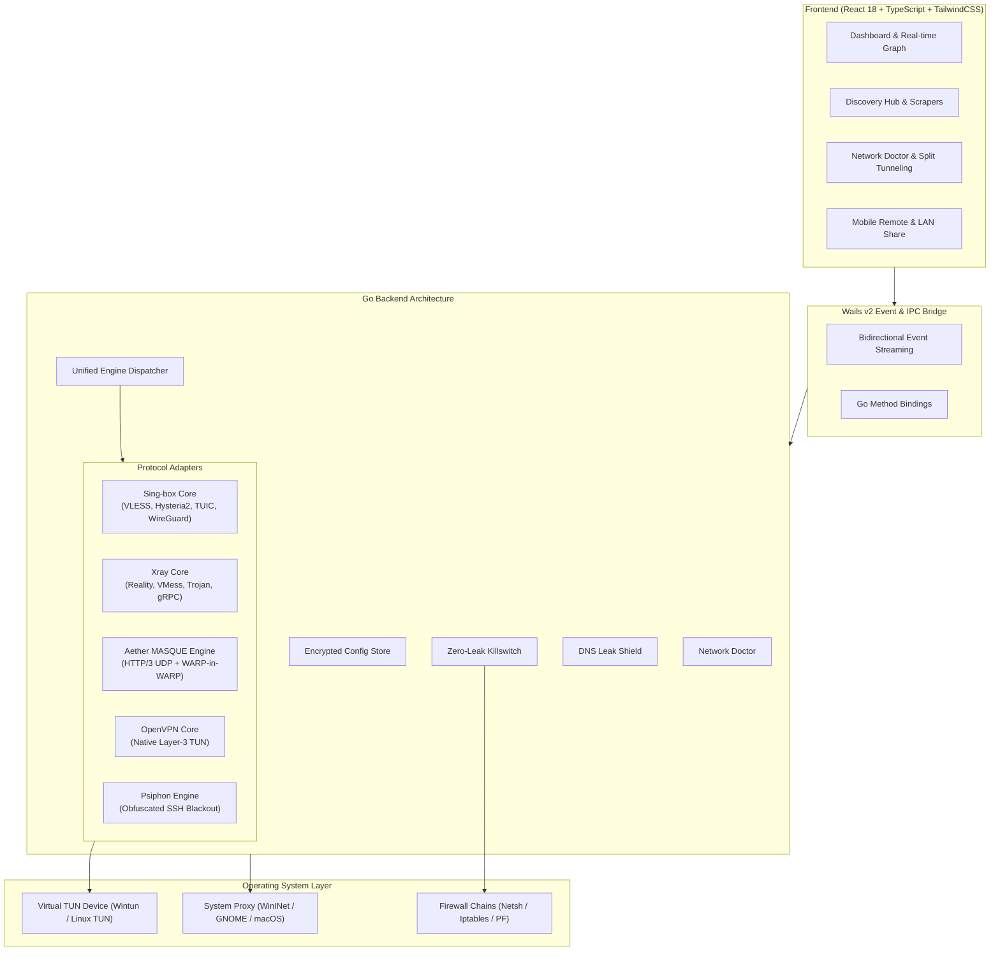

<div align="center">
  
  <h1>NexVPN Pro</h1>
  <p><b>⚡ Next-Generation Multi-Core Anti-Censorship & Privacy Gateway</b></p>
  <p><i>Unifying Sing-box, Xray, Aether (MASQUE/HTTP3), WireGuard, OpenVPN, and Psiphon under a single high-performance cross-platform desktop client.</i></p>

  <p>
    <a href="https://github.com/Rpg-420/NexVPN/releases/latest"></a>
    <a href="https://github.com/Rpg-420/NexVPN/blob/main/LICENSE"></a>
    
    
    
  </p>

  <p>
    <a href="#-key-features">Key Features</a> •
    <a href="#-architecture--engines">Engines & Architecture</a> •
    <a href="#-protocols-supported">Protocols Matrix</a> •
    <a href="#-installation">Installation</a> •
    <a href="#-build-from-source">Build from Source</a> •
    <a href="#-documentation">Documentation</a> •
    <a href="README_FA.md">🇮🇷 مستندات فارسی</a>
  </p>
</div>

---

## 🌟 Overview

**NexVPN Pro** is a state-of-the-art circumvention platform engineered to withstand severe, multi-layered Deep Packet Inspection (DPI) firewalls and national censorship blackouts. Developed using **Go, Wails v2, TypeScript, and React 18**, NexVPN eliminates single-point-of-failure routing by unifying the world's most capable networking cores into a reactive, intelligent client.

Whether dealing with active SNI filtering, TLS fingerprinting, UDP throttling, DNS poisoning, or complete protocol blocks, NexVPN dynamically adapts using intelligent scanners, multi-hop tunneling, and process-level routing.

---

## 🚀 Key Features

### 🧠 Unified Multi-Engine Core Dispatcher
- Seamlessly controls and orchestrates **Sing-box**, **Xray-core**, **Aether (MASQUE/HTTP3)**, **Cloudflare WARP / WireGuard**, **OpenVPN**, and **Psiphon**.
- Zero-downtime auto-failover: Automatically detects dead servers and switches to the lowest-latency active node.

### 📡 Intelligent Discovery Hub & Scanner Suite
- **Telegram Proxy Scraper**: Real-time extraction, decryption, and live ping testing of public MTProto and V2Ray proxies.
- **Cloudflare Clean IP Scanner**: Multi-threaded CIDR scanner testing latency, jitter, and packet loss across WARP & CDN IPv4 subnets.
- **TLS Fragment Studio**: Visual editor and automatic tester for ClientHello packet splitting and sleep delays to shatter SNI-based DPI blocking.
- **Free Configs Aggregator**: Continuous live updates with ISP-optimized tagging (*MCI, Irancell, Rightel, Shatel, Mokhaberat*).
- **Smart ISP Optimizer**: Auto-detects your active Internet Service Provider and tailors fragmentation, MTU, and clean endpoints.

### 🛡️ Enterprise Security & OS Integration
- **Zero-Leak Kill Switch**: Kernel-level firewall lockdown (*Windows Netsh, Linux iptables/nftables, macOS pfctl*) ensuring zero IP exposure if connections drop.
- **Multi-Resolver DNS Leak Shield**: Probes and enforces DNS queries through encrypted resolvers (*Cloudflare, Quad9, Google, OpenDNS, Custom DoH/DoT*).
- **Process-Based App Split Tunneling**: Route only specific applications (or bypass domestic apps and online banking) at the OS process level.
- **Smart Network Doctor & Emergency Repair**: One-click recovery to purge DNS caches, reset Winsock stacks, clear zombie system proxies, and terminate dangling core processes.
- **Linux Polkit Daemon**: Passwordless background execution using `cap_net_admin` capabilities without repetitive `sudo` prompts.

### ⚡ Productivity & Power Ecosystem
- **Mobile Remote Web Companion**: Control your desktop VPN from any smartphone on your local Wi-Fi via a secure, PIN-authenticated QR code.
- **LAN Proxy Sharing**: Share encrypted tunnel access with Smart TVs, gaming consoles, and mobile devices across your local network.
- **P2P Nearby Sync**: Auto-discover local NexVPN clients on LAN to instantly synchronize profiles and clean IP pools.
- **Cloud Sync & Encrypted Vault**: Backup and restore profiles with AES-GCM encrypted vaults or GitHub Gist sync.
- **Gaming Mode HUD**: Low-jitter UDP booster with MTU optimization and an interactive desktop Floating Mini Widget.
- **Interactive Screen QR Scanner**: Scan proxy QR codes directly from screen regions, image files, or webcams.

---

## 📐 Architecture & Engines



---

## 📊 Protocols Matrix

| Protocol | Engine | Transport / Security | DPI Bypass Score | UDP Acceleration | Best Use Case |
| :--- | :--- | :--- | :---: | :---: | :--- |
| **VLESS Reality** | Sing-box / Xray | TCP, gRPC, WebSocket | 🟢 **99%** | ✅ | Strict SNI filtering & DPI evasion |
| **Aether MASQUE** | Aether Native | HTTP/3 UDP / Nested WARP | 🟢 **98%** | 🚀 Turbo | National blackouts & UDP throttling |
| **Hysteria 2** | Sing-box | Custom QUIC / Brutal Congestion | 🟢 **96%** | 🚀 Extreme | Lossy mobile networks & gaming |
| **TUIC v5** | Sing-box | QUIC / Congestion Control | 🟢 **95%** | 🚀 Extreme | High-speed streaming & downloads |
| **WARP / WireGuard** | Sing-box / Native | UDP + Clean IP Scanning | 🟡 **88%** | ✅ | General browsing & IP masking |
| **Trojan / VMess** | Sing-box / Xray | TLS, WS, gRPC | 🟡 **90%** | ✅ | Standard CDN & reverse proxy |
| **OpenVPN** | OpenVPN | TCP / UDP Layer-3 TUN | 🟡 **80%** | ⚠️ Standard | Enterprise & legacy infrastructure |
| **Psiphon SSH** | Psiphon | Obfuscated SSH Handshake | 🟢 **95%** | ⚠️ TCP-only | Emergency backup during total DPI block |

---

## 🛠️ Installation

### 🪟 Windows (10 / 11)
1. Download `NexVPN-Setup.exe` (or `NexVPN-windows-amd64.zip` for portable mode) from [Latest Releases](https://github.com/Rpg-420/NexVPN/releases/latest).
2. Run the installer. The installer automatically registers the high-performance **Wintun** driver and taskbar system tray integration.

### 🐧 Linux (Ubuntu / Debian / Arch / Fedora)
1. Download `NexVPN-linux-amd64.tar.gz` from Releases and extract it:
   ```bash
   tar -xvf NexVPN-linux-amd64.tar.gz
   cd NexVPN
   ```
2. **Crucial:** Run the one-time rootless initialization script:
   ```bash
   sudo ./install_linux.sh
   ```
   > 💡 *This configures Polkit policies and grants `cap_net_admin` capabilities to the core binaries so you never get prompted for sudo passwords.*

### 🍏 macOS (Intel & Apple Silicon)
1. Download `NexVPN-darwin-universal.dmg`.
2. Drag `NexVPN.app` to your `Applications` folder.

---

## 🏗️ Build from Source

### Prerequisites
- [Go 1.22+](https://golang.org/doc/install)
- [Node.js 20+ LTS](https://nodejs.org/)
- [Wails CLI v2](https://wails.io/docs/gettingstarted/installation) (`go install github.com/wailsapp/wails/v2/cmd/wails@v2.14.0`)

```bash
# 1. Clone the repository
git clone https://github.com/Rpg-420/NexVPN.git
cd NexVPN

# 2. Install frontend packages
cd frontend && npm install && cd ..

# 3. Build optimized desktop binary
wails build -clean
```

The compiled executable will be generated at `build/bin/NexVPN.exe` (or `build/bin/NexVPN`).

---

## 📚 Documentation & Website

Experience our comprehensive online guides and interactive tools:

- 🌐 **[NexVPN Official Landing Page & Interactive Tools](https://Rpg-420.github.io/NexVPN/)**
- 📖 [User Guide (English)](https://Rpg-420.github.io/NexVPN/user-guide-en.html) | [راهنمای کاربری فارسی](https://Rpg-420.github.io/NexVPN/user-guide-fa.html)
- 💻 [Developer Guide (English)](https://Rpg-420.github.io/NexVPN/developer-guide-en.html) | [راهنمای توسعه‌دهندگان فارسی](https://Rpg-420.github.io/NexVPN/developer-guide-fa.html)

---

## 🤝 Contributing

Contributions make the open-source community thrive! Please check our [Contributing Guidelines](.github/CONTRIBUTING.md) and [Code of Conduct](.github/CODE_OF_CONDUCT.md) before submitting pull requests.

---

## 📄 License

This project is licensed under the **MIT License** - see the [LICENSE](LICENSE) file for details.
