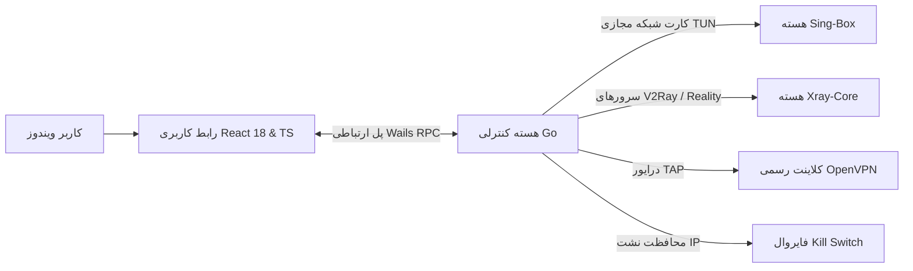

<div align="center" dir="rtl">

# ⚡ کلاینت حرفه‌ای نکس‌وی‌پی‌ان (NexVPN Pro) ⚡
### کلاینت دسکتاپ نسل جدید و چندپروتکله ضد فیلترینگ برای ویندوز

[](https://github.com/Rpg-420/NexVPN)
[](LICENSE)
[](https://github.com/Rpg-420/NexVPN)
[](https://go.dev)
[](https://reactjs.org)
[](https://t.me/nexvpnpro)

[English](README.md) • [فارسی](README_FA.md) • [راهنمای کاربری](docs/USER_GUIDE_FA.md) • [راهنمای فنی](docs/DEVELOPER_GUIDE_FA.md)

</div>

---

## 🌟 معرفی نکس‌وی‌پی‌ان

**نکس‌وی‌پی‌ان (NexVPN Pro)** یک کلاینت متن‌باز، پرسرعت و مدرن برای سیستم‌عامل ویندوز است که با ترکیب سه هسته قدرتمند جهانی شامل **Sing-Box**، **Xray-Core** و **Native OpenVPN** به همراه درایور کرنل کارت شبکه مجازی **Wintun**، بالاترین پایداری، سرعت و دور زدن پیشرفته فیلترینگ هوشمند (DPI) را برای کاربران فراهم می‌آورد.

---

## ✨ قابلیت‌ها و ویژگی‌های کلیدی

| قابلیت | توضیحات |
| :--- | :--- |
| 🚀 **پشتیبانی جامع از پروتکل‌ها** | سازگاری کامل با `VLESS Reality`، `VLESS Vision`، `VMess`، `Trojan`، `Shadowsocks`، `Hysteria 2`، `TUIC`، `WireGuard`، `WARP` و `OpenVPN`. |
| 🛡️ **مسیریابی دوگانه (Dual-Routing)** | ترکیب همزمان کارت شبکه مجازی **Wintun TUN** با پروکسی سیستمی برای اطمینان از عبور ۱۰۰٪ ترافیک تمامی برنامه‌ها و بازی‌ها. |
| 🔬 **استودیوی فرگمنت ضد فیلترینگ** | خرد کردن بسته‌های هندشیک TLS به پکت‌های بسیار ریز با تاخیر ساختگی برای دور زدن فیلترینگ SNI و فایروال‌های هوشمند. |
| 🎮 **شتاب‌دهنده گیمینگ و رفع تحریم** | بهینه‌سازی MTU روی 1400، اولویت‌بندی پکت‌های صوتی دیسکورد و بازی‌ها و مجهز به DNSهای ضد تحریم (**الکترو**، **شکن**، **بگذر** و **کلودفلر**). |
| 🔗 **زنجیره چندهاپ (Proxy Chaining)** | هدایت متوالی ترافیک از ۲ تا ۴ سرور به صورت تودرتو برای دستیابی به نهایت امنیت، ناشناسی و پایداری. |
| ⚡ **اکانت رایگان Cloudflare WARP** | ثبت‌نام ۱-کلیکه اکانت رسمی کلودفلر، تولید کلید WireGuard و قابلیت وارپ روی وارپ (Double WARP). |
| 📡 **اشتراک‌گذاری Wi-Fi در شبکه** | تبدیل کامپیوتر به درگاه پروکسی برای استفاده گوشی، تلویزیون هوشمند، پلی‌استیشن و کنسول‌ها از اینترنت آزاد. |
| 📱 **مرکز کنترل ریموت موبایل** | اسکن بارکد QR با گوشی و قطع/وصل و مدیریت برنامه از طریق مرورگر موبایل بدون نیاز به نصب هیچ اپلیکیشن اضافی. |
| 🩺 **پزشک هوشمند شبکه** | عیب‌یابی و تعمیر ۱-کلیکه شبکه، پاکسازی کش DNS، ریست Winsock و اصلاح تنظیمات پراکسی ویندوز. |
| 📊 **مانیتورینگ زنده و سهمیه حجم** | نمایش دقیق سرعت آپلود/دانلود، نمودار دینامیک ترافیک و مدیریت سهمیه ماهانه مصرف اینترنت. |
| 🌐 **رابط کاربری دوزبانه و زیبا** | تم تاریک سایبری مدرن با پشتیبانی کامل از زبان فارسی (راست‌چین با فونت وزیرمتن) و انگلیسی. |

---

## 🏗️ معماری کلی سیستم



---

## 🚀 راهنمای نصب و راه‌اندازی سریع

### روش ۱: دریافت نسخه آماده (Release)
1. آخرین نسخه برنامه را از بخش [Releases](https://github.com/Rpg-420/NexVPN/releases) دانلود نمایید.
2. فایل `NexVPN.exe` را با دسترسی ادمین (Run as Administrator) اجرا کنید.
3. لینک کانفیگ یا سابسکریپشن خود را اضافه کرده یا دکمه **ساخت اکانت WARP** را بزنید.
4. دکمه **اتصال** را فشرده و از اینترنت آزاد و پرسرعت لذت ببرید!

### روش ۲: کامپایل از سورس‌کد

#### پیش‌نیازها
* زبان [Go 1.22+](https://go.dev/dl/)
* محیط [Node.js 18+](https://nodejs.org/) و `npm`
* ابزار Wails CLI: `go install github.com/wailsapp/wails/v2/cmd/wails@latest`
* ابزار go-winres: `go install github.com/tc-hib/go-winres@latest`

#### دستورات بیلد
```powershell
# کلون کردن مخزن
git clone https://github.com/Rpg-420/NexVPN.git
cd NexVPN

# نصب پکیج‌های فرانت‌اند
cd frontend
npm install
cd ..

# اجرای اسکریپت ساخت نسخه نهایی
powershell -ExecutionPolicy Bypass -File .\build.ps1
```
فایل اجرایی نهایی در مسیر `build\bin\NexVPN.exe` ساخته خواهد شد.

---

## ⌨️ کلیدهای میانبر سراسری ویندوز

| کلید میانبر | عملکرد |
| :--- | :--- |
| `Ctrl + Shift + C` | اتصال / قطع فوری فیلترشکن |
| `Ctrl + Shift + S` | تست سرعت لحظه‌ای اینترنت |
| `Ctrl + Shift + R` | باز کردن رادار وضعیت اپراتور |
| `Ctrl + Shift + L` | فعال/غیرفعال‌سازی اشتراک Wi-Fi |
| `Ctrl + Shift + E` | تعمیر اضطراری شبکه |
| `Ctrl + Shift + Q` | باز کردن مدیریت سهمیه حجم |

---

## 🤝 کانال و پشتیبانی رسمی

* 📢 **کانال تلگرام**: [@nexvpnpro](https://t.me/nexvpnpro)
* 💬 **پشتیبانی و پیشنهادات**: [@nexvpnpro](https://t.me/nexvpnpro)
* 🐛 **گزارش باگ و مشکلات**: [ثبت در گیت‌هاب](https://github.com/Rpg-420/NexVPN/issues)

---

## 📄 لایسنس
توسعه یافته تحت لایسنس [MIT](LICENSE) با هدف دسترسی آزاد، امن و پایدار به اینترنت جهانی.
