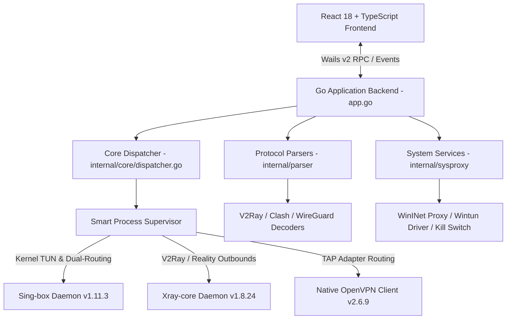

# NexVPN Pro v1.1.0 — Architecture & Developer Guide

Welcome to the **NexVPN Developer Guide**. This technical documentation covers the underlying system architecture, Go backend services, protocol parsers, frontend state management, inter-process communication (IPC) bindings, and cross-compilation toolchains.

---

## 🏛️ System Architecture Overview



### High-Level Layers
1. **Frontend Presentation Layer**:
   * Built with **React 18**, **TypeScript**, and **TailwindCSS** with full RTL (Right-to-Left) and LTR bilingual support.
   * Uses **Lucide React** for icons, **Recharts** for real-time telemetry plotting, and **Framer Motion** for UI transitions.
2. **IPC & RPC Bridge Layer**:
   * Uses **Wails v2** to expose strongly-typed Go functions to the webview runtime via JavaScript bindings (`frontend/src/wailsjs/go/main/App`).
3. **Core Routing & Process Management Layer**:
   * Implemented in Go (`internal/core`, `internal/parser`, `internal/sysproxy`, `internal/config`).
   * Supervises daemon child processes, captures stdout/stderr telemetry streams, calculates real-time bandwidth consumption, and manages OS-level network routing tables.

---

## 📂 Repository Directory Structure

```
.
├── app.go                  # Main Wails application bindings and RPC API handlers
├── app_extra.go            # Additional utility APIs (IP testing, speed testing, logs)
├── main.go                 # Application entrypoint and Windows OS signal trapping
├── build.ps1               # Production build script (Vite + go-winres + Wails)
├── dev.ps1                 # Local development launcher
├── wails.json              # Wails project manifest and build configuration
├── winres/                 # Native Windows resource definitions (icons, manifests)
│   ├── winres.json         # Resource manifest (Per-Monitor DPI, App icons, version)
│   └── icon.ico            # Multi-resolution application icon (16px - 256px)
├── bin/                    # Protocol daemon binaries and DLLs
│   ├── sing-box.exe        # Sing-box universal core
│   ├── xray.exe            # Xray-core daemon
│   ├── openvpn.exe         # OpenVPN client
│   ├── wintun.dll          # Wintun kernel driver DLL
│   ├── geoip.dat           # MaxMind GeoIP database
│   └── geosite.dat         # Domain category database
├── docs/                   # User and developer documentation
├── internal/               # Core Go packages
│   ├── config/             # Profile persistence, app preferences, JSON stores
│   ├── core/               # Daemon life-cycle management, kill switch, traffic stats
│   ├── parser/             # VLESS, VMess, Trojan, SS, WireGuard & OVPN config parsers
│   └── sysproxy/           # WinINet proxy settings, TAP/Wintun drivers, network doctor
└── frontend/               # React 18 + Vite frontend codebase
    ├── src/
    │   ├── components/     # Modals (Fragment, Gaming, DNS Leak, Remote, Backup, etc.)
    │   ├── lib/            # Wails API wrapper, sound FX, i18n dictionaries, utils
    │   ├── pages/          # Dashboard, V2Ray, WireGuard, OpenVPN, Settings, Logs
    │   └── types/          # TypeScript interface definitions
    └── package.json        # Frontend dependencies and Vite build scripts
```

---

## ⚙️ Key Backend Subsystems

### 1. Unified Dispatcher (`internal/core/dispatcher.go`)
The `Dispatcher` manages all active network sessions:
* Automatically selects the optimal core engine:
  * **Sing-box**: Used for system-wide TUN routing, WireGuard/WARP, multi-hop chaining, and complex routing rules.
  * **Xray-Core**: Used for standalone VLESS Reality, WebSocket, gRPC, and mixed proxies.
  * **OpenVPN**: Used for native `.ovpn` TAP tunnels.
* Spawns child processes using `exec.Command` with `CREATE_NO_WINDOW` flags on Windows.
* Attaches io pipes to parse live bandwidth and connection events without spawning detached console windows.

### 2. Protocol Parser & Config Generator (`internal/parser/parser.go`)
Translates user configurations into valid, schema-compliant JSON/config files for Sing-box and Xray:
* **VLESS / VMess / Trojan / Shadowsocks**: Decodes URI parameters (`security=reality`, `pbk`, `sid`, `sni`, `fp`, `type=grpc`).
* **Sing-box Inbounds & Outbounds**: Dynamically generates `tun` inbounds, `mixed` local SOCKS5/HTTP inbounds, and nested `detour` chains.
* **DNS Resolution**: Enforces TCP/DoH resolvers (`tcp://1.1.1.1` and `tcp://8.8.8.8`) to guarantee zero UDP drops during DPI filtering.

### 3. Dual-Routing & System Proxy (`internal/sysproxy/sysproxy.go`)
* Configures WinINet registry keys (`Software\Microsoft\Windows\CurrentVersion\Internet Settings`) for `ProxyServer` and `ProxyEnable`.
* Registers clean recovery hooks so proxy settings are restored even if the application experiences unexpected termination.

---

## 🛠️ Building & Developing

### Prerequisites
* **Go**: `v1.22+`
* **Node.js**: `v18+` & `npm`
* **Wails CLI**: `go install github.com/wailsapp/wails/v2/cmd/wails@latest`
* **go-winres**: `go install github.com/tc-hib/go-winres@latest`

### Running in Development Mode
```powershell
.\dev.ps1
# Or directly:
wails dev
```

### Production Compilation
```powershell
.\build.ps1
```
The compiled, self-contained binary with embedded icons, manifests, and frontend assets will be generated at:
```
build\bin\NexVPN.exe
```

---

## 🤝 Contributing Guidelines

1. **Fork the Repository** on GitHub.
2. **Create a Feature Branch**: `git checkout -b feature/awesome-feature`
3. **Ensure Code Quality**:
   * Frontend: Run `npm --prefix frontend run build` to verify zero TypeScript lint errors.
   * Backend: Run `go vet ./...` and `go test ./...`.
4. **Submit a Pull Request** with a detailed description of your changes.
